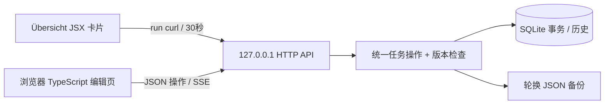

# 本地 V1 架构及 V2 边界

## 需求决策

目标是可靠的个人日计划，不部署云端。Übersicht 1.6 负责桌面层和 React/JSX；编辑页用 TypeScript 和浏览器原生 DOM，避免再加载一套 React、路由或打包器。Node 24 内置 SQLite，减少常驻依赖。Web 页面、JS/CSS 只来自本机，不加载 CDN、字体或分析服务。



`server/`：校验、日期规则、存储及统一操作、HTTP 安全边界。`web/`：编辑器及编译产物。`widget/`：独立 JSX 与可配置外观。`scripts/`：用户级安装、进程和 launchd 生命周期。`shared/`：模型类型。`examples/`：只读示例。`tests/`：自动化。可选登录启动把运行代码和单个 Node 可执行文件安装到用户 Application Support/DailyPlannerApp；仓库更新后重新 login enable 同步安装副本。

## 数据与一致性

稳定 UUID 为任务 ID，绝不用数组下标。日期是固定 IANA 时区（默认 Asia/Shanghai）的 YYYY-MM-DD，分钟数为整数。createdAt/updatedAt 为 UTC ISO 时间。有效状态 todo/in_progress/done/cancelled，优先级 low/medium/high。预计 1..1440 分钟；实际为 null 或 0..10080。

写操作在 SQLite 事务内读取全局 revision 并比较 expectedRevision，成功后统一递增 revision。过期的页面/卡片写入得到 409，不做最后写入者覆盖。重排必须提交当日完整 ID 集合。跨日移动将任务追加到目标日期。取消任务从总量/时长中排除，进度按完成任务数计算。

批量导入和自然语言预留接口共用模拟器：验证完整输入，在副本应用操作，生成预览和汇总；只有在预览有效期及原 revision 未变时允许应用。任务、历史和版本在同一事务提交。撤销校验目标变更仍是当前版本后恢复前态，产生新版本。预览在内存，服务重启后要重新预览；真实任务和可撤销历史持久化。

修改前备份是额外恢复手段；SQLite 是唯一权威数据。损坏时启动失败并保留原始文件，绝不无提示创建空计划冒充恢复。停止服务后从已知正常 JSON 备份在新数据目录预览导入，再核对；保留损坏文件供检查。

## 安全及性能

HTTP 只监听 127.0.0.1。校验 Host，浏览器 Origin 只允许当前本机编辑页的精确来源；null/外站 Origin 和跨站 Fetch 被拒绝。写入还要求 application/json 和 X-Daily-Planner: 1，阻止普通跨站表单请求。无通配 CORS、无 LAN 绑定、无 shell 内容插值的任意执行接口。任务内容按文本渲染，不能执行 HTML。原生 curl 可无 Origin 调用；这是一台单用户 Mac 的信任边界，不试图防御已经能以当前用户身份运行程序的恶意软件。

Widget 用 Übersicht 原生 run 桥调用固定 curl/open 命令，JSON 参数进行 shell 转义，不把标题拼成代码。桌面检查间隔 30 秒，手动刷新/勾选后马上读取；编辑器通过 SSE 接收其他标签的变化。V1 编辑器到桌面最多约 30 秒延迟，不调用需要额外 Automation 授权的 AppleScript 刷新。无每秒轮询，无持续高频动画。离线时保留旧任务并显示提示，禁止误把旧 revision 当新状态。

默认 Node 常驻一个进程；Übersicht 自身已有渲染进程。默认卡片最多 6 个任务，剩余任务显示数量并链接完整编辑页，限定高度防溢出。主屏、Space 和桌面层由 Übersicht 管理，不改 Finder 或 macOS 安全策略。

## 统一操作接口

GET `/api/state` 返回 revision/timezone/today/tasks/summary；GET `/api/export` 导出；GET `/api/events` SSE；GET `/health` 进程健康。POST `/api/operations` 接收 `{operation,args,expectedRevision}`。读操作/预览不要求 expectedRevision，所有写入必须提供。

| 操作 | 参数 | 行为 |
|---|---|---|
| listTasks | date 或 from/to，可空 | 读取并按日期/顺序排列 |
| getTask | id | 查询稳定 ID |
| createTask | task | 创建，服务补 ID/时间 |
| updateTask | id, patch | 编辑白名单字段 |
| moveTask | id, date | 跨日移动 |
| deleteTask | id | 删除并返回 changeId |
| reorderTasks | date, ids | 当日完整排序 |
| previewChanges | operations 或 import:{plan,mode} | 只模拟，返回 previewId、baseRevision、每日统计 |
| applyChanges | previewId | 校验版本后事务写入 |
| undoChanges | changeId | 校验当前版本后撤销 |

详细字段与实际返回结构以 [CONTRACT.md](../CONTRACT.md)、共享模型和测试为准。示例：

```sh
curl -H 'Content-Type: application/json' -H 'X-Daily-Planner: 1' \
  --data '{"operation":"listTasks","args":{}}' \
  http://127.0.0.1:43117/api/operations
```

## 未来 MCP 与 ChatGPT

本地操作接口不是远程 MCP Server。此 V1 不注册 ChatGPT 工具、不创建隧道、不暴露 Mac 服务，也不暗示 ChatGPT 能访问 localhost。未来 MCP 是另一层有明确认证的适配器，将受控工具映射至相同领域操作；需要单独设计传输、设备身份、权限和确认 UI。

ChatGPT 对插件/工具的调用权限来自用户安装、连接和授权，不由本地 API 的存在自动获得。读取、预览与执行应分别授权，执行必须引用用户看过的 previewId、revision 和变更摘要，不接受自然语言模型直接覆盖数据库。

V2 流程：解析“明天”“周末”为配置时区的具体日期 → list/get → previewChanges → 展示减少/增加时长、移动日期及每日总量 → 用户确认 → applyChanges → 返回 changeId 和撤销入口。任何并发更新均使预览失效，必须重新生成并确认。V1 已实现本地的这些操作，但未连接任何模型。

本地与云端没有同步。未来若选择同步，必须单独确定最小传输字段、用户同意、远端存储与删除策略、离线冲突处理和审计；不能默认上传完整计划或密钥。桌面服务仍只绑定 loopback，由用户明确选择的安全桥接组件访问。
